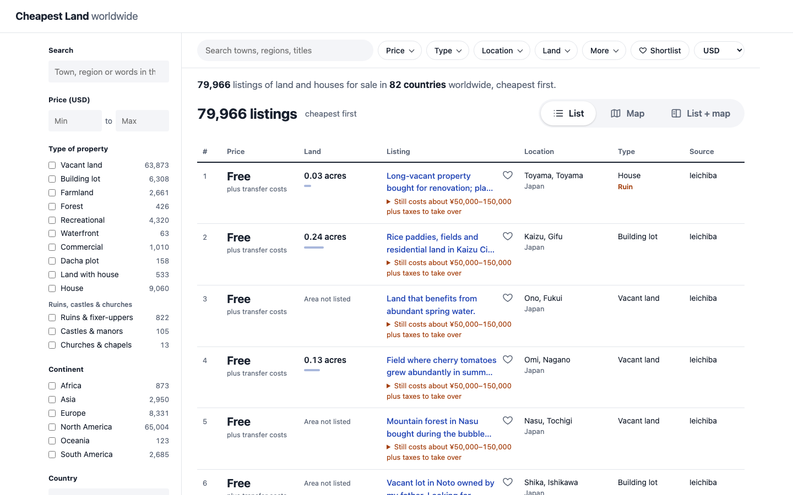
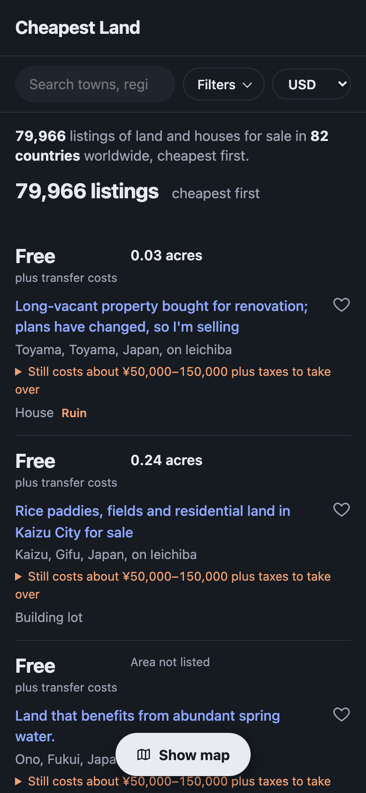
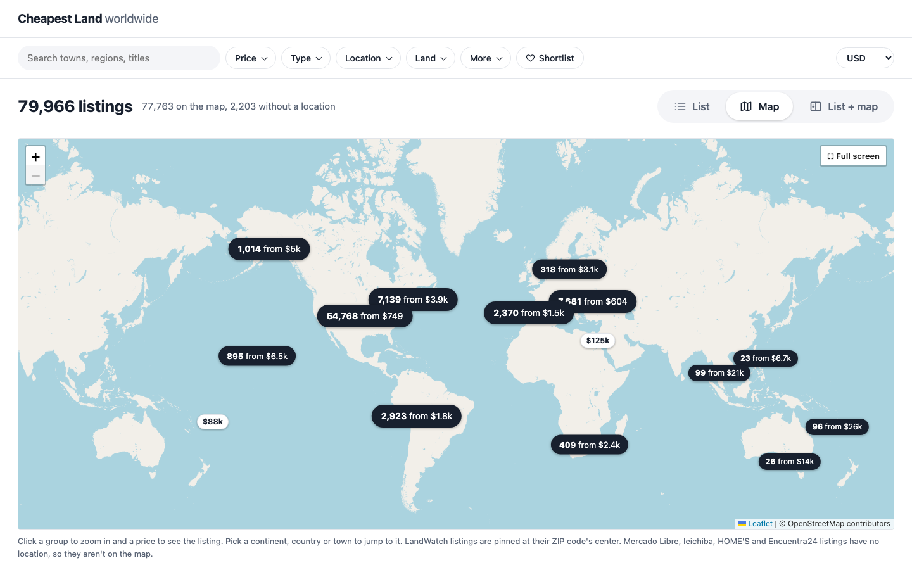
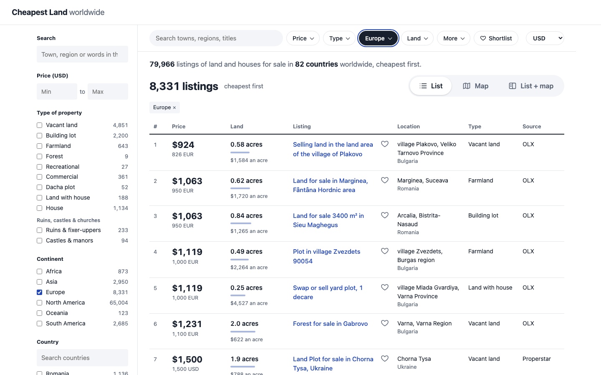

<div align="center">


# landfinder

**The cheapest land for sale anywhere on earth, ranked by what you'd actually pay.**

landfinder scrapes land and house listings from big listing portals around the world, converts every price to
US dollars, and ranks them by **total price**, so the top row is the cheapest piece of land you can actually buy.
Every row links to the live listing.

[](https://github.com/waleedrizwan/landfinder/actions/workflows/tests.yml)
[](https://cheapest-land.pages.dev)
[](LICENSE)


[Quick start](#-quick-start-macos) · [Usage](#%EF%B8%8F-usage) · [Sources](#-sources) · [The website](#%EF%B8%8F-the-website) · [How it works](#%EF%B8%8F-how-it-works) · [Tests](#-tests) · [Legal](#%EF%B8%8F-legal)

</div>

<br>

| Every listing, cheapest first | On a phone, in dark mode |
|---|---|
|  |  |
|  |  |

<sub>Screenshots are taken from the real site with `tools/screenshots.py`.</sub>

## ✨ Highlights

- 🌍 **11 sources, ~150 countries.** Land plots, houses, ruins and castles, from the US and Canada to Japan's empty-house banks.
- 💵 **One currency, any currency.** Every price is converted to USD for ranking; the site switches to whatever currency you pick.
- 📊 **Spread across the market.** Each search covers every price up to $200,000, not just the bottom of the barrel.
- 🧹 **Junk filtered out.** Down payments, per-m² prices, rentals, auctions, wanted ads and reposts are caught and flagged.
- 🗺️ **A map and filters.** Search by country, town, type, size and price; the map groups thousands of pins.
- 🏚️ **Ruins, castles & churches.** Special listings are tagged by keyword in a dozen languages.
- 💸 **Steals & good deals.** Each land listing is compared with the 40 most similar ones nearby (close in place and size, prices scaled to its size). Far below their typical price is a good deal (≤40%) or a steal (≤25%); under 10% is treated as a likely data error, not a bargain. Fixed rules, no AI: the same data always gives the same tags.
- 🈳 **Everything in English.** Foreign titles are translated once with Claude Haiku and cached.
- 🖥️ **A live dashboard.** Watch every Chrome window, every site's blocks and the time left while it runs.

## 🚀 Quick start (macOS)

Needs **Python 3.9+** and **Google Chrome**. Dependencies are listed in `requirements.txt`; `run.sh` installs them
into `.venv` on first run.

```sh
git clone https://github.com/waleedrizwan/landfinder.git
cd landfinder
./run.sh            # first run creates .venv and installs dependencies
```

By default, 8 small Chrome windows open tiled on the right half of your screen. Each one scrapes a
different country or state at the same time, and a banner at the top shows what it's working on. Pages
are drawn at half size, so sites still serve their desktop layout. If a window gets closed, the script
reopens it.

> [!NOTE]
> A full run takes about **20–40 minutes** with 8 windows, and each window uses about 1.1 GB of memory.
> Use `--workers 4` on a smaller machine.

> [!TIP]
> **One-click run:** double-click `scrape.command` in Finder (or a copy of it on the Desktop). A Terminal window
> opens, runs a full fresh scrape with the Chrome windows hidden and the dashboard open, keeps the Mac awake, then
> rebuilds and publishes the site. Options work from a shell too: `./scrape.command --workers 4`.

<details>
<summary><b>The dashboard window</b></summary>

<br>

A run also opens a dashboard window (`dashboard.py`, a small Tk app; `--no-dashboard` leaves it closed): the phase
it's in, searches done and a rough time left, every window's and thread's current page, pages per minute, new
listings, and per site the pages fetched, failures, blocks and seconds per page, with the log underneath. There is no
server: the scraper rewrites `data/progress.json` every 2 seconds and the window reads it, so
`.venv/bin/python dashboard.py` opens it again for a run started elsewhere. Its Stop button writes `data/stop`, which
ends the run the way Ctrl-C does: the pages in progress finish, everything collected is saved, and the site is built.

It also tracks every time a site takes us for a bot: a bot-check page in Chrome (Properstar's Azure WAF, Cloudflare's
"Just a moment", "Access Denied"), an HTTP 401/403/429/503 over plain requests, a results page with no listing data on
it (a captcha or sign-in page, or a changed layout), or REALTOR.ca's API answering with a wall. Each one is listed as
it happens (time, site, what the site sent, which window, which page), the Sites table shows how many got through
after waiting, and a chart shows blocks per run and per site across the last 30 runs. The events are kept in
`data/blocks.jsonl` and each run's totals (pages, failures and blocks per site) in `data/runs.jsonl`. Once a site has
blocked 3 pages in a row (`--give-up N`, 0 = keep trying) the rest of its pages are skipped for that run, since each
blocked page costs about three minutes of retries and only sends the site more refused requests: the dashboard says
so, its listings already on disk stay on the site, and the next run tries the site again.

</details>

## ⌨️ Usage

```sh
./run.sh                                         # everything: 250 believable listings per search, spread up to $200,000
./run.sh --sources properstar --listings 500     # go deeper on one source
./run.sh --countries paraguay,bolivia,argentina  # only these countries (Properstar, OLX, Mercado Libre)
./run.sh --report-only                           # rebuild outputs from saved data
./run.sh --fresh                                 # re-scrape pages already done
```

<details>
<summary><b>All options</b></summary>

<br>

| Option | What it does |
|---|---|
| `--sources olx,mercadolibre` | Only some sources |
| `--listings 500` | Believable listings wanted per search (default 250) |
| `--countries paraguay,bolivia` | Only these countries (Properstar, OLX, Mercado Libre) |
| `--states new-mexico,arizona` | Only these US states (LandWatch, Zillow) |
| `--provinces nova-scotia,saskatchewan` | Only these provinces (Kijiji, REALTOR.ca) |
| `--central-america CR,PA` | Only these countries (Encuentra24) |
| `--prefectures nagano` | Only these Japanese prefectures (HOME'S akiya bank) |
| `--report-only` | Rebuild outputs from saved data |
| `--no-translate` | Don't translate new titles (no `claude` CLI calls) |
| `--fresh` | Re-scrape pages already done |
| `--workers 4` | Chrome windows in parallel (default 8) |
| `--tile full` | Tile windows over the whole screen |
| `--hidden` | No visible windows: minimized to the Dock |
| `--no-dashboard` | Don't open the dashboard window |
| `--give-up 0` | Keep trying a site that blocks page after page (default: skip it after 3) |
| `--pages 50` | Pages allowed per search (default 30) |
| `--more california=2000,texas=1000` | Search these places deeper (default `california=2000`; `''` for none) |
| `--reach 300000` | Spread every search up to this price in USD (default $200,000) |
| `--house-listings 60` | Believable listings wanted per house search (default 60) |
| `--no-houses` | Search land only |
| `--verify 0` / `--verify-only` | Skip, or only run, the full-description check |

</details>

Stopping with **Ctrl-C** is safe: progress is saved in `data/`, and running the same command again resumes.

<details>
<summary><b>How a search is spread over prices</b></summary>

<br>

A search is one country, state or province on one site, and it wants 250 believable listings (`--listings`): ones
the site shows by default, with no flag except a missing land area, and not one exact low price repeated on many
different-size plots.

A search doesn't just take the cheapest 250: those are all desert parcels and village plots at a few thousand
dollars, while land at $100,000–$200,000 is still cheap. So every search is spread over the prices up to $200,000
(`--reach`, converted to the site's currency): the range is cut into 20 equal slices of $10,000 and each slice gives
an equal share of the 250 listings, cheapest first within the slice (a house search, wanting 60, uses 5 slices of
$40,000). A slice with too few listings passes what it couldn't give to the next ones. A market with no more
listings under `--reach` than the search wants is read straight through, cheapest first, with no slices. The
search stops at `--reach` (`price reached` in the coverage report) when the market has fewer listings than wanted,
or after 30 pages (`--pages`; raised when needed so every slice gets a page).

REALTOR.ca's API refused a browser's calls after about six (seen 2026-11-09), so a province there gets 4 slices of
$50,000 instead of 20. Three searches still go cheapest first with no slices: Properstar's castles (few and dear), HOME'S akiya bank
(no price filter we can use) and Ieichiba, which is read in full up to ¥100M. LandWatch pages through at most
500 results of any search; a slice holding more comes back as a sample spread over the slice.

California is searched deeper than the rest: 2,000 believable listings instead of 250 (100 per slice), with its
house search and page cap raised by the same ratio (8x). `--more` sets which places get this and how many.

</details>

<details>
<summary><b>How fake prices, rentals and duplicates are caught</b></summary>

<br>

After scraping, landfinder opens the 60 cheapest believable listings on LandWatch, Kijiji and Properstar and
re-reads their full description, because search results cut it short (Properstar's carry none at all). That
catches sellers who enter a down payment or monthly payment as the price ("Only $2,700 cash! ... $380 down").
When the text gives the real cash price, that price is used; otherwise the listing is hidden. It also catches
rentals: real estate agents' REALTOR.ca listings include homes and land for rent, priced at the monthly rent,
which land in Kijiji's land-for-sale section, and Properstar's agencies post land for rent as "for sale" with
the rent as the price ("Terreno en venta o renta", "$100 pesos m2 renta"). Use `--verify 0` to skip this step
or `--verify-only` to run it alone. It follows `--sources`, so `--verify-only --sources kijiji` checks Kijiji
alone, without opening Chrome.

Rentals are also caught from the words sellers use, in a dozen languages ("for lease", "renta", "wynajem",
"оренда", 借地...), and from prices that can't be a sale: a home under $40 per m² of floor space (floor space
comes with Properstar, OLX and Mercado Libre house listings), or a home under $10,000 in a country where no home
sells for that (the US, Canada, Australia, the UK, Germany and the like; cheap ruins in Portugal, Italy, France or
Bulgaria are real and stay). On Kijiji, a REALTOR.ca commercial or industrial lot in Canada at a few thousand
dollars, with no talk of buyers, offers or the seller, is a lease at its monthly rent.

The same parcel often turns up several times: an agency's listing fed to Properstar twice under different
titles, a REALTOR.ca lot on two MLS boards, a Kijiji ad reposted under a new id, the same plot on OLX and
Properstar, or a seller posting a row of identical lots one ad each. Listings in the same country at the same
price are folded into one when they share a title, a location and size, or the same opening description text
and size. The site shows the fullest one with "+2 similar" after the site name.

</details>

## 🌐 Sources

| Source | Coverage | How it's fetched |
|---|---|---|
| [Properstar](https://www.properstar.com) | ~150 countries, land plots and houses, plus a castles search in each country | 🌐 real Chrome via Playwright (site has a bot check) |
| [LandWatch](https://www.landwatch.com) | all 50 US states | 🌐 real Chrome via Playwright |
| [Zillow](https://www.zillow.com) | lots and land in all 50 US states | ⚡ plain HTTP requests |
| [Kijiji](https://www.kijiji.ca) | every Canadian province/territory | ⚡ plain HTTP requests |
| [REALTOR.ca](https://www.realtor.ca) | Canada's MLS: vacant land and houses, every province/territory | 🌐 real Chrome via Playwright: the map page's own listing API, called from inside the page |
| [OLX](https://www.olx.pl) | Poland, Ukraine, Romania, Portugal, Bulgaria, Kazakhstan, Uzbekistan | ⚡ OLX's JSON search API |
| [Mercado Libre](https://inmuebles.mercadolibre.com.ar) | Argentina, Mexico | ⚡ plain HTTP requests |
| [Encuentra24](https://www.encuentra24.com) | Costa Rica, Panama, Nicaragua, Honduras, Guatemala, El Salvador | 🌐 real Chrome via Playwright (Cloudflare blocks plain requests) |
| [Immobiliare.it](https://www.immobiliare.it) | all of Italy | 🌐 real Chrome via Playwright |
| [Ieichiba](https://www.ieichiba.com) (家いちば) | Japan: empty houses (akiya) and land sold by their owners | ⚡ plain HTTP requests |
| [HOME'S akiya bank](https://www.homes.co.jp/akiyabank/) | Japan: municipal empty-house banks, all 47 prefectures | 🌐 real Chrome via Playwright |

The source names for `--sources` are `properstar`, `castles`, `landwatch`, `zillow`, `kijiji`, `realtor`, `olx`, `mercadolibre`,
`encuentra24`, `immobiliare`, `ieichiba` and `homes` (`ALL_SOURCES` in `landfinder.py`). The sites that answer plain
HTTP requests each run in their own thread alongside the Chrome windows, so adding one barely changes how long a run takes.

<details>
<summary><b>Price floors and per-site quirks</b></summary>

<br>

Each search is spread over the prices up to $200,000 (see Usage). Properstar and Mercado Libre results start at $1,500, because cheaper
"prices" there are almost always per-m² figures or placeholders; Zillow and Immobiliare.it start at $1,000 (and €1,000)
and REALTOR.ca at CAD 1,000 for the same reason. OLX searches start at $500 to $1,500 depending
on the country (`OLX_SITES` in `landfinder.py`): real village plots in Bulgaria, Portugal and Kazakhstan sell for
a few hundred dollars, while in Ukraine, Uzbekistan and Poland a price that low is nearly always per m² or per
sotka (100 m²). Mercado Libre's other countries ask visitors to sign in, so they aren't included.

REALTOR.ca's listing API takes a map box, so each province is searched by a box around it, kept to the listings the
API places in that province, and answers at most 600 listings per search (12 pages of 50). Its search results carry no
description, so the lease and payment-plan text checks don't apply to it; the search itself asks for sales only. Many
REALTOR.ca listings also reach Kijiji through its REALTOR.ca feed, under a seller-written title, so the same lot can
show from both sources. REALTOR.ca's terms of use don't allow automated access; see [Legal](#%EF%B8%8F-legal).

Ieichiba is a Japanese board where owners sell empty houses and land themselves. landfinder takes every live listing
up to ¥10M (about $65k) from its price bands (`/tags/0-100manyen` and up). Prices there really are that low: owners pay
yearly tax on houses nobody wants, so ¥0 to ¥300,000 is common. Ieichiba listings skip the "price too low" and
placeholder checks, and a ¥0 listing shows as Free. Land area comes from the description ("土地：1,000㎡", or 坪,
3.3 m² each). Titles and towns are translated like the other non-English sources.

</details>

## 🗺️ The website

Every run builds a small static website in `site/`: every listing seen in the last 3 days, cheapest
first, with search and filters, plus a map. On the map, nearby listings group into bubbles showing how many
there are and the cheapest price; click one to zoom in, click a price pin to see the listing, or pick a
country or city to jump to it. The live copy is at **https://cheapest-land.pages.dev** (password protected).

<details>
<summary><b>Towns, currencies and translations</b></summary>

<br>

Picking a country adds a City list: that country's towns that have listings under the other filters. The town comes
from LandWatch's address, the place before the province or postal code on Kijiji, before the region on OLX and before
the state on Mercado Libre, and Properstar's city. In the US and Canada, where town names repeat from state to state,
towns read "Deming, NM"; Properstar listings there have no state, so they take the state of the nearest listing that has one.
The list puts the biggest towns first. Populations come from [GeoNames](https://www.geonames.org) (CC BY 4.0): every
place with 1,000+ people, matched by any of its names, kept in `geo/town_population.tsv.gz` (rebuild it with
`tools/build_town_population.py`). Smaller towns, and the ones no name matches, follow A to Z.

Prices show in US dollars until you pick another currency from the Currency list, which has every currency
open.er-api.com gives a rate for. The browser remembers the choice, and the map pins and price filters switch with it.
Each card names its currency, and a listing posted in a different currency shows its own price under the converted
one ("Converted from 16,500 CAD"). Prices are converted at the exchange rates from the day the site was built.

LandWatch listings come without coordinates, so they're pinned at their ZIP code's center, from the US Census
ZIP code file in `geo/us_zip_centroids.csv.gz` (2024 ZCTA Gazetteer). Mercado Libre, Ieichiba, HOME'S and Encuentra24
listings have no location and only appear in the list.

Everything on the site is in English. Titles that aren't (OLX, Mercado Libre, French Kijiji ads, the odd German
or Spanish Properstar title) and place names in Cyrillic are translated with Claude when the site is built: the
`claude` CLI with the Haiku model, 80 texts per call. Translations are cached in `data/translations.json`, so each
text is only sent once and a daily run only translates new listings. Hover a title on the site to see the
original; searching in the original language still works. `--no-translate` skips the step, and without the
`claude` CLI the original text is kept.

</details>

<details>
<summary><b>Property types, houses, ruins and castles</b></summary>

<br>

Each card is tagged with the kind of property: vacant land, building lot, farmland, forest, recreational,
waterfront, commercial, dacha plot, land with house, or house. The Type filter shows one kind. LandWatch tags come
from LandWatch's own category, or "land with house" when the card lists beds, baths or square feet. For the other
sites, the tag comes from words in the title, its English translation and the description, in each site's languages.
So the tag is a good guess, not a guarantee: "build your dream cottage" still counts as vacant land, and a house the
seller doesn't mention goes unnoticed. Tagging makes no Claude calls. House listings stay hidden with the flagged ones
unless you pick House in the Type filter or one of the ruins and castles below.

Besides land, every search also runs in the same site's houses-for-sale section, cheapest first: Properstar's houses,
LandWatch's homes, Kijiji's houses for sale, OLX's houses and Mercado Libre's *casas*. The cheapest houses on earth are
mostly ruins, abandoned farmhouses and fixer-uppers, which is what these searches are for. A house search stops at 60
believable listings (`--house-listings`) instead of 250, so the house searches take much less time than the land ones. `--no-houses` searches land only.

The "Ruins, castles & churches" group in the Type of property filter picks out special listings, found by keywords in the title, its English translation and the
description, in each site's languages (no Claude calls):

| Tag | Matches |
|---|---|
| 🏚️ **Ruins & fixer-uppers** | a ruin, an abandoned or derelict building, a house for demolition or one that needs a full renovation ("ruína", "à rénover", "da ristrutturare", "do remontu", "под снос", "за събаряне", "空き家", "fixer-upper") |
| 🏰 **Castles & manors** | castle, château, manoir, castelo, castillo, palácio, conac, замък. Only the title counts (a description's castle is usually the one in town), and places, streets and addresses named after one ("New Castle, IN", "for sale in Castelo, Brazil", "Chateau Drive") don't. Properstar's own castle category counts from 400 m² of floor space, since agents set it on ordinary houses too |
| ⛪ **Churches & chapels** | a former, old or converted church or chapel, or one for sale ("former church building", "antiga igreja"), not one nearby ("next to the old church") or a street ("Church Lane") |

A listing can have more than one, and each shows as a tag under its type. Every Japanese akiya (空き家, "empty house") counts as a
ruin. Castles and churches are rare at the cheap end: searches go up from the cheapest listing, so a $400,000 château
only turns up in a country with few houses for sale.

</details>

### Viewing it locally

Serve `site/` (opening `index.html` as a file won't work, because the page fetches `data.json`):

```sh
python3 -m http.server 8000 --directory site    # then open http://localhost:8000
```

After editing `site_template.html` you can rebuild the page from the existing `site/data.json`, without
scraping: `.venv/bin/python tools/rebuild_site.py`.

### Publishing and daily updates

| Command | What it does |
|---|---|
| `./publish.sh` | Deploys `site/` to the Cloudflare Pages project `cheapest-land` with `wrangler` (run `npx wrangler login` once first). `site/` isn't checked into git; `functions/` (password gate, visitor counter) deploys with it. |
| `./scrape.command` | The daily job started by hand, with a Terminal window and the dashboard (see Quick start). |
| `./install_daily.sh` | Schedules `daily.sh` with launchd: a fresh scrape at 6:00 every morning with windows hidden, then a deploy. A sleeping Mac runs it on wake. Logs go to `logs/`. `./install_daily.sh 7 30` changes the time; `./install_daily.sh off` removes it. |

> [!IMPORTANT]
> The site asks for a password (`functions/_middleware.js`): every page, `data.json` and the API answer only to a
> browser that has logged in, and the login sets a cookie that lasts 30 days. Only the Privacy, Terms and Open source
> pages open without it. The password is the project's `SITE_PASSWORD` secret; set or change it with
> `npx wrangler pages secret put SITE_PASSWORD --project-name cheapest-land` (changing it logs everyone out). For
> local testing put `SITE_PASSWORD=...` in `.dev.vars` (not committed) and run `npx wrangler pages dev site`.

## 📦 Output

| File | What's in it |
|---|---|
| **`report.html`** | Open it in a browser for a sortable, filterable table of every listing. |
| **`results.csv`** | The same data, cheapest total price first. `type` is the property type shown on the site; `tags` lists which of ruin, castle and church it is. |
| **`coverage.csv`** | One row per search, showing how much of each market the site covers: the listings the site itself reports (above our price floor), how many we fetched (`fetched_pct`), how many believable ones the site shows, the price the crawl got up to (`reached_usd`) and why it stopped (`enough listings`, `end of results`, `price reached`, `page cap` or `fetch failed`). The log sums it up per source and names countries with a single source or under 10 believable listings. |
| **`data/`** | Raw scraped records, exchange rates and crawl progress. |

The `flags` column marks listings to double-check:

| Flag | Meaning |
|---|---|
| `price too low` | Probably a monthly payment or a per-m² price |
| `may be payment plan price` | The text mentions "/mo", "down", and so on |
| `auction/tender` | The price may be a minimum bid |
| `wanted ad` | Someone looking to buy, not a listing |
| `share of a property`, `allotment garden`, `burial plot` | Not a whole plot you'd own outright |
| `wrong currency` | The title gives a much higher US dollar price than the listed one |
| `no land area listed` | Price per acre can't be computed |

The text checks cover English, French and Spanish plus the OLX languages (Polish, Ukrainian, Russian, Romanian,
Bulgarian, Portuguese, Uzbek), e.g. leases, payment plans, auctions and prices per m² or per sotka.
Exchange rates come from [open.er-api.com](https://open.er-api.com) and are cached daily.

## ⚙️ How it works

Everything is in `landfinder.py`:


1. **Scrape.** Kijiji, OLX, Mercado Libre, Ieichiba and Zillow are fetched with `requests` (`Plain`), one thread
   each. Properstar (land, houses and castles), LandWatch, Immobiliare.it, Encuentra24 and HOME'S akiya bank are
   loaded in real Chrome through Playwright (`Browser`), several windows at once, each taking the next search off a
   shared queue (`run_pool`, `BROWSER_CRAWLERS`). Each source has a parser that turns a search page into records;
   `crawl_search` pages through the simpler ones until `search_pages` says the search has enough believable
   listings.
2. **Store.** `Store` appends every record to `data/listings.jsonl` and every finished page URL to
   `data/pages_done.txt`. The newest line per listing URL wins, so prices stay current and a stopped run resumes.
3. **Verify.** `verify_cheapest` opens the cheapest believable LandWatch, Kijiji and Properstar listings and re-reads
   their full description (see Usage).
4. **Score.** `finalize` converts prices to USD (`load_fx`, `to_usd`), swaps down payments for the real cash price
   (`fix_down_payment`), works out USD per acre and adds warning flags (`flag`). `build_outputs` then adds the checks
   that need the whole dataset: one price repeated on many plot sizes, a "total" that would only buy ~20 m² at
   the country's usual price, prices far below the rest of the country, and reposts of the same parcel.
5. **Publish.** `build_outputs` writes `results.csv`, `report.html` and `coverage.csv`. `build_site` keeps listings
   seen in the last 3 days, turns each listing's flags into one-letter codes (`site_codes`), writes
   `site/data.json`, copies `site_template.html` to `site/index.html` (which draws the list, the filters and the
   Leaflet map from `data.json`) and copies the legal pages from `legal/`.

A listing counts as believable when it has no flags, or only "no land area listed" (house listings also show when
you pick House or Castles). Only those appear in the list and on the map until you tick "Include flagged listings".
Empty houses on the Japanese akiya sites (Ieichiba, HOME'S) rank with the land: there the house is what you buy.

### Adding a source

1. Write `parse_<site>()`, which turns one search page into listing dicts (`source`, `country`, `region`,
   `title`, `description`, `price`, `currency`, `acres`, `lat`, `lon`, `url`), and `crawl_<site>()`, which hands
   `crawl_sliced()` two functions: the URL of page p of the listings within a price range (cheapest first), and a
   loader that fetches and parses that page. `crawl_sliced()` does the rest: the price slices, the page limits,
   saving each page and recording why the search stopped. `crawl_olx` is a short example.
2. Register it in `main()`: sites that answer plain HTTP requests go in the `plain` list (one thread each),
   sites that need a real browser go in the `jobs` passed to `run_pool`.
3. Add it to the default `--sources`, and to `srcName` and the Source filter in `site_template.html`.
4. Run it alone first (`./run.sh --sources <site> --pages 2 --verify 0`) and look at the cheapest listings in
   `results.csv`. New sites usually need a price floor or a few extra flags before their cheapest listings are real.

## 🧪 Tests

```sh
./test.sh                 # sets up .venv like run.sh, adds pytest, runs everything
./test.sh -m "not e2e"    # skip the browser tests
./test.sh -k kijiji       # just the tests with "kijiji" in the name
```

The suite never touches the network: exchange rates are fixed, and the source parsers run against trimmed copies
of real search pages in `tests/fixtures/` (contact details replaced).

| File | Covers |
|---|---|
| `test_helpers.py` | Number and area parsing (`acres_from_text`, decimal commas), currency conversion, placeholder prices |
| `test_flags.py` | Every sanity flag, the down-payment fix, and the flag-to-site-code mapping |
| `test_parsers.py` | The Properstar (land and castles), LandWatch, Kijiji and HOME'S parsers and the LandWatch full-description reader |
| `test_outputs.py` | `build_outputs` end to end in a temp folder: per-m² and placeholder detection, reposts, castles, `results.csv`, `report.html`, `coverage.csv` and the rows of `site/data.json` |
| `test_price_bands.py`, `test_more.py` | Spreading searches over price slices, and the places searched deeper (`--more`) |
| `test_dashboard.py` | The live run data the dashboard window reads (`data/progress.json`), and its Stop button |
| `regressions/` | One file per fixed bug, named after the bug and what broke (`test_b017_kijiji_block_page.py`), so it can't come back |
| `test_e2e.py` | Builds the site from the fixtures and loads it in headless Chromium at 1440×900 and 390×844 (country filter, search, empty state, flagged listings, the map tab, the error message when `data.json` fails). If a `site/` build exists it is checked too. |

The browser tests use Playwright's Chromium (`.venv/bin/playwright install chromium`); if that isn't installed
they fall back to any headless shell already in the Playwright cache, and skip if there is none.
CI runs the whole suite on Python 3.9 and 3.12 for every push and pull request (`.github/workflows/tests.yml`).
When a site changes its markup, refresh the matching fixture by saving one search page and trimming it to a few
listings; the parser tests show which fields are expected.

`tools/` has small probe scripts used to work out Properstar's URL parameters and LandWatch's page structure,
`rebuild_site.py` (see above), and `screenshots.py`, which retakes the README screenshots from the current `site/` build.

## ⚖️ Legal

> [!WARNING]
> Listing data belongs to the sites it comes from. Use this for personal research, keep the default delays
> between page loads, and check each site's terms. **REALTOR.ca's terms of use forbid automated access outright**;
> it is included because it is the only full picture of land for sale in Canada, and `--sources` can leave it out.

> [!CAUTION]
> Cheap per-acre land is often remote, landlocked or unbuildable, and many countries restrict foreign ownership.
> Verify access, zoning, title and ownership rules before buying anything. Nothing here is legal, financial or
> real estate advice.

The site carries its own [privacy policy](legal/privacy.html), [terms & disclaimer](legal/terms.html) and
[open source credits](legal/licenses.html). It's built with [Leaflet](https://leafletjs.com) (BSD-2) and
[Leaflet.markercluster](https://github.com/Leaflet/Leaflet.markercluster) (MIT), with map data
© [OpenStreetMap](https://www.openstreetmap.org/copyright) contributors, town data from
[GeoNames](https://www.geonames.org) (CC BY 4.0), US ZIP centroids from the US Census Bureau, and
[rates by Exchange Rate API](https://www.exchangerate-api.com). landfinder isn't affiliated with any listing site.

## 🤝 Contributing

Issues and pull requests are welcome. See [CONTRIBUTING.md](CONTRIBUTING.md) for setup and conventions, and
[SECURITY.md](SECURITY.md) to report a security problem privately.

<div align="center">

<br>

Released under the [MIT License](LICENSE).

</div>
