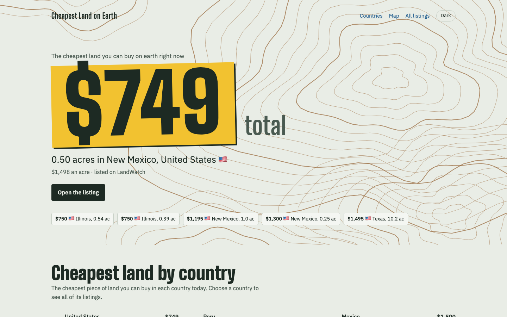
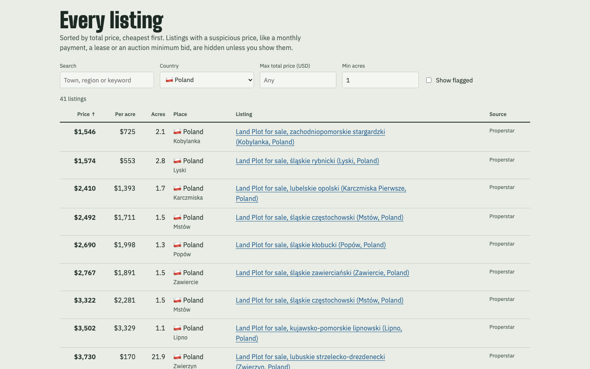

# landfinder

Find the cheapest land for sale anywhere on earth. landfinder scrapes land listings from big listing
portals, converts every price to US dollars, and ranks them by **total price**, i.e. the cheapest piece of land you can
actually buy. Price per acre is shown too. Every row links to the live listing.

The results are published daily at **https://cheapest-land.pages.dev**.

| Desktop | Phone (dark mode) |
|---|---|
|  |  |
|  |  |

## Sources

| Source | Coverage | How it's fetched |
|---|---|---|
| [Properstar](https://www.properstar.com) | ~150 countries, land plots | real Chrome via Playwright (site has a bot check) |
| [LandWatch](https://www.landwatch.com) | all 50 US states | real Chrome via Playwright |
| [Kijiji](https://www.kijiji.ca) | every Canadian province/territory | plain HTTP requests |

Each search is sorted cheapest first. Properstar results start at $1,500, because cheaper "prices" there
are almost always per-m² figures or placeholders.

## Quick start (macOS)

Needs Python 3.9+ and Google Chrome.

```sh
git clone https://github.com/waleedrizwan/landfinder.git
cd landfinder
./run.sh            # first run creates .venv and installs dependencies
```

By default, 4 small Chrome windows open tiled on the right half of your screen. Each one scrapes a
different country or state at the same time, and a banner at the top shows what it's working on. Pages
are drawn at half size, so sites still serve their desktop layout. If a window gets closed, the script
reopens it. A full run (10 pages per country/state/province) takes under an hour with 4 windows.

## Usage

```sh
./run.sh                                         # everything, 10 pages each
./run.sh --sources properstar --pages 25         # go deeper on one source
./run.sh --countries paraguay,bolivia,argentina  # only these Properstar countries
./run.sh --states new-mexico,arizona,nevada      # only these US states (LandWatch)
./run.sh --provinces nova-scotia,saskatchewan    # only these provinces (Kijiji)
./run.sh --report-only                           # rebuild outputs from saved data
./run.sh --fresh                                 # re-scrape pages already done
./run.sh --workers 6                             # more windows in parallel (default 4)
./run.sh --tile full                             # tile windows over the whole screen
./run.sh --hidden                                # no visible windows: minimized to the Dock
```

After scraping, landfinder opens the 60 cheapest believable listings and re-reads their full description,
because search results cut it short. That catches sellers who enter a down payment or monthly payment as
the price ("Only $2,700 cash! ... $380 down"). When the text gives the real cash price, that price is used;
otherwise the listing is hidden. Use `--verify 0` to skip this step or `--verify-only` to run it alone.

Stopping with Ctrl-C is safe: progress is saved in `data/`, and running the same command again resumes.

### Looking at the site locally

Every run writes the site to `site/`. To view it, serve that folder (opening `index.html` as a file won't
work, because the page fetches `data.json`):

```sh
python3 -m http.server 8000 --directory site    # then open http://localhost:8000
```

After editing `site_template.html` you can rebuild the page from the existing `site/data.json`, without
scraping: `.venv/bin/python tools/rebuild_site.py`.

## Website and daily updates

Every run also builds a small static website in `site/`. It shows today's cheapest listing, the
cheapest land in each country, a map and a filterable table of every listing seen in the last 3 days.
The live copy is at **https://cheapest-land.pages.dev**.

- `./publish.sh` deploys `site/` to the Cloudflare Pages project `cheapest-land` with `wrangler`. Run
  `npx wrangler login` once first. Nothing else is deployed: `site/` is plain static files (`index.html`,
  `data.json`) and is not checked into git.
- `./install_daily.sh` schedules `daily.sh` with launchd: a fresh scrape at 6:00 every morning, with
  windows hidden in the Dock, then a deploy. If the Mac is asleep at that time, macOS runs the job when it
  wakes. Logs go to `logs/`. Use `./install_daily.sh 7 30` to change the time, or `./install_daily.sh off`
  to remove the job.

## Output

- **`report.html`**: open it in a browser for a sortable, filterable table of every listing.
- **`results.csv`**: the same data, cheapest total price first.
- **`data/`**: raw scraped records, exchange rates and crawl progress.

The `flags` column marks listings to double-check:

- `price too low`: probably a monthly payment or a per-m² price
- `may be payment plan price`: the text mentions "/mo", "down", and so on
- `auction/tender`: the price may be a minimum bid
- `wanted ad`: someone looking to buy, not a listing
- `no land area listed`: price per acre can't be computed

Exchange rates come from [open.er-api.com](https://open.er-api.com) and are cached daily.

## Tests

```sh
./test.sh                 # sets up .venv like run.sh, adds pytest, runs everything (about 3 seconds)
./test.sh -m "not e2e"    # skip the browser tests
./test.sh -k kijiji       # just the tests with "kijiji" in the name
```

The suite never touches the network: exchange rates are fixed, and the source parsers run against trimmed copies
of real search pages in `tests/fixtures/` (contact details replaced).

- `test_helpers.py`: number and area parsing (`acres_from_text`, decimal commas), currency conversion, placeholder prices
- `test_flags.py`: every sanity flag, the down-payment fix, and the flag-to-site-code mapping
- `test_parsers.py`: the Properstar, LandWatch and Kijiji parsers and the LandWatch full-description reader
- `test_outputs.py`: `build_outputs` end to end in a temp folder: per-m2 and placeholder detection, reposts,
  `results.csv`, `report.html`, `site/data.json`, the hero and the country ranking
- `test_e2e.py`: builds the site from the fixtures and loads it in headless Chromium at 1440x900 and 390x844
  (filters, sorting, empty state, the error message when `data.json` fails). If a `site/` build exists it is
  checked too.

The browser tests use Playwright's Chromium (`.venv/bin/playwright install chromium`); if that isn't installed
they fall back to any headless shell already in the Playwright cache, and skip if there is none.

When a site changes its markup, refresh the matching fixture by saving one search page and trimming it to a few
listings; the parser tests show which fields are expected.

## How it works

Everything is in `landfinder.py`:

1. **Scrape.** Kijiji is fetched with `requests` (`Plain`). Properstar and LandWatch are loaded in real Chrome through
   Playwright (`Browser`), several windows at once, each taking the next country or state off a shared queue
   (`run_pool`). Each source has a parser that turns a search page into records: `parse_properstar` reads the
   page's `__INITIAL_STATE__` JSON, `parse_kijiji` its `__NEXT_DATA__` JSON, and `parse_landwatch` the HTML
   result cards.
2. **Store.** `Store` appends every record to `data/listings.jsonl` and every finished page URL to
   `data/pages_done.txt`. The newest line per listing URL wins, so prices stay current and a stopped run resumes.
3. **Verify.** `verify_cheapest` opens the cheapest believable LandWatch listings and re-reads their full description.
4. **Score.** `finalize` converts prices to USD (`load_fx`, `to_usd`), swaps down payments for the real cash price
   (`fix_down_payment`), works out USD per acre and adds warning flags (`flag`). `build_outputs` then adds the checks
   that need the whole dataset: one price repeated on many plot sizes, a "total" that would only buy ~20 m² at
   the country's usual price, prices far below the rest of the country, and reposts of the same parcel.
5. **Publish.** `build_outputs` writes `results.csv` and `report.html`. `build_site` keeps listings seen in the last
   3 days, turns each listing's flags into one-letter codes (`site_codes`), writes `site/data.json`, and fills
   `site_template.html` with the hero and country ranking (`write_site`), so the top of the page needs no
   JavaScript. The full table and the Leaflet map load `data.json` when you scroll toward them.

A listing counts as believable when it has no flags, or only "no land area listed". Only those appear in the
hero, the country ranking and the map; the table shows the rest when you tick "Show flagged".

## Notes

- Listing data belongs to the sites it comes from. Use this for personal research, keep the default
  delays between page loads, and check each site's terms.
- Cheap per-acre land is often remote, landlocked or unbuildable, and many countries restrict
  foreign ownership. Verify access, zoning, title and ownership rules before buying anything.
- `tools/` has small probe scripts used to work out Properstar's URL parameters and LandWatch's page structure,
  and `rebuild_site.py` (see above).
